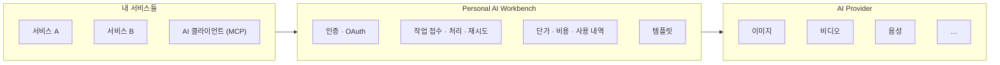

# Personal AI Workbench

내 서비스들이 함께 쓰는 AI 작업대, **Personal AI Workbench**  
: **연결은 한 번, 비용은 정확히**

 

## 어떤 서비스인가요?

이미지 · 비디오 · 음성 같은 외부 AI 기능을 **하나의 작업 API** 로 묶어,
내가 만드는 여러 서비스가 함께 쓰는 AI 계층이에요.

서비스는 *AI 를 어떻게 부르는지* 대신 **무엇을 원하는지**만 말하면 돼요.
어느 Provider 에 어떻게 보내고, 언제 끝났는지 확인하고, 얼마였는지 적어두는 일은 Workbench 가 해요.

 

## 왜 만들게 되었나요?

AI 기능을 서비스에 붙일 때마다 같은 고민을 반복하게 됩니다.

> '이 Provider 는 결과를 바로 주나, 나중에 알려주나?'  
> '방금 만든 이미지 한 장은 얼마였지?'  
> '지난번에 잘 나왔던 그 요청, 어떻게 보냈더라?'

새 서비스를 만들 때마다 이걸 처음부터 다시 해야 할까요?

- Provider 마다 다른 API 를 또 붙이고 🔌
- 비용은 월말 청구서로 확인하고 🧾
- 잘 나온 요청은 메모장에 적어두고 📝

**Personal AI Workbench** 는 이 일을 한 곳에 모으려고 시작했어요.
AI 기능은 한 번만 연결해 두고, 어느 서비스에서든 같은 방식으로 맡겨요.
무엇을 · 어떤 모델로 · 얼마에 만들었는지는 요청 하나하나에 남아요.

 

## 이런 걸 하려고 해요

| | 하려는 것 | 예를 들면 |
|:-:|---|---|
| 🧩 | **어떤 AI 기능이든 요청 하나로** | 이미지 · 비디오 · 음성 · decision API 를 같은 `POST /api/jobs` 하나로 |
| ⏳ | **맡겨두고, 결과는 나중에** | 요청은 바로 접수, 처리는 뒤에서. 실패하면 알아서 다시 |
| 💰 | **요청 하나하나의 비용까지** | "이번 달 이미지에 얼마 썼지?" — 모델별 · 요청별로 바로 확인 |
| 📦 | **급하지 않으면 더 싸게** | 밤사이 받아도 되는 요청은 Batch API 로 모아 보내기 |
| 📝 | **자주 하는 요청은 템플릿으로** | '블로그 썸네일' 템플릿에 제목만 넣으면 늘 같은 화풍으로 |
| 🔐 | **내 서비스들이 안전하게 연결** | 다른 서비스 · AI 클라이언트(MCP)가 OAuth 로 내 권한 안에서만 |

 

## 설계 결정

**할 일 큐는 Task 테이블 그 자체예요.**
접수할 때 Job 과 Task 를 한 트랜잭션에 쓰고, Poller 가 테이블에서 꺼내 Worker 에 넘겨요.
인프로세스 이벤트는 재시작하면 사라지고, outbox 테이블을 따로 두면 같은 상태가 두 곳에 남아 둘 다 택하지 않았어요. → [#14](https://github.com/youngsu5582/personal-ai-workbench/pull/14)

**비용에는 출처를 붙여요.**
Provider 가 직접 알려준 비용 · 단가표로 계산한 비용 · 추정한 비용을 나눠 담아요.
단가표를 고쳐 다시 계산할 때 Provider 가 알려준 실측값까지 덮어쓰지 않게 하려고요.
지금은 호출마다 사용량을 남기고, 단가표 계산은 만드는 중이에요. → [#31](https://github.com/youngsu5582/personal-ai-workbench/pull/31)

 

## 바라보는 곳

새 서비스를 만들 때 AI 가 **연동할 대상이 아니라 부탁할 곳**이 되는 것.
그리고 그 부탁이 얼마였는지 언제든 정확히 답할 수 있는 것.

지금은 이미지 생성부터 하나씩 만들어 가고 있어요 → [걸어온 길과 다음 걸음](docs/roadmap.md)

 

## 더 보기

- **기술 스택** — Kotlin · Spring Boot · Spring Modulith · JPA + jOOQ · PostgreSQL · S3 호환 보관소
- [개발 가이드](docs/development.md) — 로컬 실행 · 설정 · 보관소
- [도메인 모델](docs/domain/domain-model.md) · [모듈러 모놀리스와 Spring Modulith](docs/architecture/modular-monolith-and-modulith.md)
