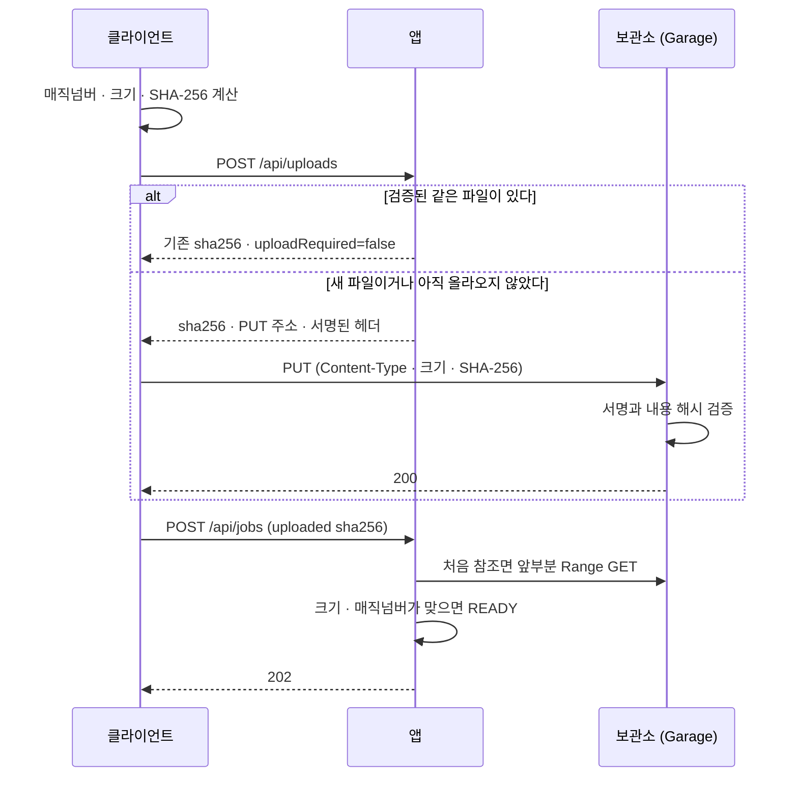

# 보관소에 직접 올리기 (presigned upload)

앱은 업로드할 위치와 조건을 서명하고, 바이트는 클라이언트에서 보관소로 바로 간다.
앱이 파일 전체를 받으면 메모리와 전송을 함께 부담하므로 presigned PUT 을 쓴다.

## 흐름



## 내용을 서명하는 이유

presigned URL 은 사용 횟수를 제한하지 않는다. 형식과 크기만 고정하면 같은 주소로 다른 이미지를 덮어쓸 수 있다.
SHA-256 을 함께 서명하면 같은 주소의 재전송도 같은 바이트만 통과한다. READY 는 다시 판정하지 않으므로 이 고정이 필요하다.

발급 요청의 `sha256` 은 소문자 hex 64자다. S3 체크섬 헤더는 원본 digest 32바이트의 Base64 이므로
`Sha256.base64` 로 표기를 바꾼다. 클라이언트는 발급 응답의 `x-amz-checksum-sha256` 과
`x-amz-sdk-checksum-algorithm` 을 PUT 에 그대로 보낸다. 브라우저의 버킷 CORS 에도 두 헤더를 허용한다.

`S3PresignedUploadIssuerTest` 는 실제 Garage 에서 다른 내용, 변경한 체크섬, 빠진 체크섬이 거절되고
기존 객체가 보존되는지 확인한다. 같은 내용의 재전송은 허용한다.

## 소유자 안에서 중복을 판정한다

정체성은 `(owner_user_uuid, sha256)` 이다. 사용자 사이에서 같은 해시를 조회하면 남의 파일 보관 여부가 새어 나간다.
업로드와 생성 결과 모두 SHA-256 을 공개 파일 식별자로 쓴다. 같은 바이트의 생성 결과 행은 Task 이력을 위해 각각 남는다.

- READY: PUT 주소 없이 기존 SHA-256 를 돌려준다. 보관소를 다시 읽지 않는다.
- PENDING: 중복 발급이면 보관소의 앞부분을 한 번 읽어 판정한다. 아직 객체가 없으면 같은 위치의 주소를 다시 발급한다.
- REJECTED: 같은 형식의 요청은 400 이다. 다른 형식으로 정정하면 같은 행을 PENDING 으로 다시 연다.
  PNG 를 JPEG 라고 선언한 탓에 같은 파일을 영원히 올리지 못하게 해서는 안 된다.

동시 최초 발급은 DB 유니크 제약과 `UploadedFileRepository.insertIfAbsent` 로 한 행에 모은다.
충돌 후 재조회는 실패한 트랜잭션에서 하지 않도록 `ON CONFLICT` 로 처리한다.
상태 변경은 조건부 UPDATE 이고, `updated_at` 도 함께 대조해 정정 전 판정이 새 PENDING 을 덮지 못하게 한다.
보관소를 읽는 동안에는 트랜잭션을 열지 않는다.

## 결과물과 쓰기 위치를 나눈다

`BlobKey.uploaded` 는 `users/{owner}/uploads/ab/cd/{hash}.{ext}` 를 만든다.
생성 결과물의 `blobs/` 와 팬아웃 규칙은 같지만 객체를 공유하지 않는다.
업로드의 쓰기 권한으로 생성 결과물을 바꾸거나, 거절된 업로드를 지우며 결과물까지 지우는 일을 막는다.

형식 정정은 저장 키의 확장자와 metadata 를 함께 바꾼다.
거절 판정이 이전 위치를 지우는 중에 정정돼도 새 형식의 위치는 영향을 받지 않는다.

## 내용 판정은 앞부분까지다

보관소가 SHA-256 을 검증해도 그것이 PNG 라는 뜻은 아니다.
앱은 있는가 · 선언한 크기인가 · 앞부분의 매직넘버가 선언한 형식인가만 확인한다.
PNG·JPEG·WebP 를 허용하고, 디코드와 재인코딩은 실제로 이미지를 여는 Provider 가 맡는다.
큰 픽셀 수의 이미지를 앱이 디코드해 메모리를 소비할 이유가 없기 때문이다.

판정 전과 REJECTED 에는 읽기 주소도 바이트도 내주지 않는다.
아직 올라오지 않은 파일은 PENDING 에 남고, 올린 뒤 다시 참조할 수 있다.
외부 입력으로 쓸 때는 워커가 읽기 주소를 발급한다. 대기 중 주소가 만료되지 않게 큐에는 파일 해시만 둔다.
Provider 가 주소를 받아가지 못하면 같은 입력을 바이트로 한 번 더 보낸다.

## complete API 와 검증 후 이동을 두지 않는 이유

앱은 PUT 을 볼 수 없고 Garage 는 업로드 완료 알림을 지원하지 않는다.
complete API 를 둬도 앞부분을 읽어 판정하는 일은 같고, 클라이언트에게 호출 순서 하나만 더 생긴다.
첫 업무 동작인 I2I 접수나 중복 발급이 그 판정을 맡는다.

검증 후 이동이 막는 내용 바꿔치기는 체크섬 서명으로 막는다. 같은 바이트만 다시 올라오므로 최종 위치로 옮길 필요가 없다.
READY 도 업로드 위치에 남으므로 prefix lifecycle 로 지우면 안 된다. 쓰이지 않은 PENDING 정리는 DB 상태를 기준으로 한다.

## 기존 데이터

V8 은 생성 결과의 해시 컬럼을 준비하고, 일회성 `.claude/scripts/migrate-file-hashes.py` 가 기존 행과 Job 입력 JSON 을 변환한다.
해시 경로인 결과는 키에서 복원하고, UUID 경로의 업로드는 바이트를 읽어 계산한다.
V9 는 변환이 끝난 뒤 해시를 NOT NULL 로 고정하고 파일 UUID 컬럼을 제거한다. 사용자·Job·Task 의 UUID 는 유지한다.
도구는 기본 dry-run 이며, 실행 시 DB 백업·원본 JSON·UUID→해시 매핑·SQL·검증 결과를 남긴다.
유실 파일을 제외하려면 `--skip-missing` 을 명시한다. 해당 파일과 연결된 요청은 백업 후 활성 테이블에서 제외하며 사용량 원장은 유지한다.

기존 DB 는 앱과 워커를 멈춘 뒤 다음 순서로 변환한다. 빈 DB 는 이 과정 없이 Flyway 를 적용한다.

```bash
python3 .claude/scripts/migrate-file-hashes.py                 # 대상 확인
python3 .claude/scripts/migrate-file-hashes.py --apply         # 백업 → V8 → 변환 → V9
# 유실 파일도 제외하기로 했다면 위 두 명령에 --skip-missing 을 추가한다.
```

설정은 기본적으로 워크트리의 `.env` 를 읽는다. 실제 로컬 보관소 주소가 다르면 `--s3-endpoint` 를 지정한다.
해시를 아직 채우지 않은 기존 DB 에서 앱을 먼저 시작하면 V9 의 NOT NULL 검증이 실패한다.

API 와 클라이언트 사용법은 [개발 가이드](../development.md#직접-업로드-url-발급)에 있다.
