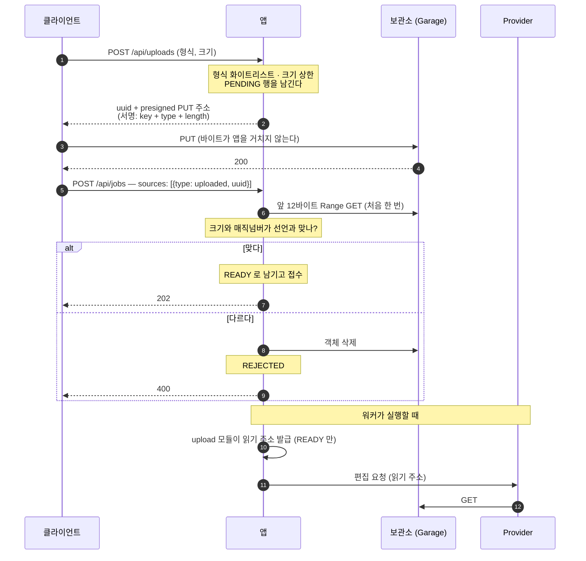

# 보관소에 직접 올리기 (presigned upload)

> **한 문장**: 앱은 "올려도 된다"는 주소만 발급하고, 바이트는 클라이언트에서 보관소로 바로 간다.
> 그 파일이 정말 쓸 만한지는 **처음 쓰일 때** 앱이 앞부분만 읽어 판정한다.

앱이 파일을 받지 않는다. `MultipartFile` 은 힙에 통째로 올라오는데, 그건 결과물을 내려보낼 때 이미 걷어낸 모양이다.

---

## 흐름



- **발급** `POST /api/uploads` — PNG·JPEG·WebP, 1바이트~20MiB. 키는 서버가 `users/{owner}/uploads/{uuid}` 로 만든다.
  로컬 보관소처럼 직접 업로드를 못 하면 `501`.
- **판정** — 처음 참조될 때 한 번. 아직 안 올라왔으면 판정하지 않고 `400` 이며 PENDING 이 그대로 남는다 — 올리고 다시 보내면 된다.
  보관소에 닿지 못하면 `503`.
- **읽기** — 워커가 실행할 때마다 새로 받는다. 큐에는 uuid 만 있어 대기하는 사이에 주소가 만료되지 않는다.
  Provider 가 그 주소를 받아가지 못하면(로컬 보관소처럼) 같은 입력을 바이트로 한 번 더 보낸다.
- 스크립트: `./scripts/upload.sh img.png` → `SOURCE_TYPE=uploaded ./scripts/i2i.sh <uuid> "…"`

상태는 `uploaded_files.status` 하나다. `PENDING → READY | REJECTED` 로 한 번만 움직인다.

---

## 왜 complete API 가 없나

흔한 설계는 클라이언트가 PUT 뒤에 "다 올렸다" 를 한 번 더 부르는 것이다. 앱은 PUT 을 볼 수 없고,
Garage 는 버킷 이벤트 알림을 지원하지 않아 보관소가 대신 알려줄 수도 없다.

그래도 두지 않는다. **보관소를 읽는 일은 complete 든 첫 참조든 같고, 시점만 다르다.**
complete 가 더하는 것은 "올렸다" 신호를 보내는 왕복 1번, 공개 API 라는 계약, 그리고 클라이언트에게 생기는
순서 의무다 — 잊으면 그 업로드는 영원히 쓸 수 없다.

큰 서비스의 complete 도 대개 신호가 아니라 **첫 업무 동작**이다. Slack 은 완료와 채널 공유가 한 호출이고,
Shopify 는 완료가 곧 파일 등록이다. 여기서 첫 업무 동작은 i2i 접수다.

업로드 직후 결과를 보여줄 화면이 생기면, 같은 판정 함수를 부르는 얇은 엔드포인트로 붙인다.

---

## 판정은 어디까지 하나

**있는가 · 선언한 크기인가 · 앞부분이 선언한 형식의 매직넘버인가** 까지다.

```
PNG   89 50 4E 47 0D 0A 1A 0A
JPEG  FF D8 FF
WebP  RIFF ···· WEBP      ← RIFF 는 WAV·AVI 도 쓰는 그릇이라 8번째의 WEBP 까지 본다
```

디코드나 재인코딩은 하지 않는다. OWASP 는 매직넘버만으로는 부족하다고 하지만, 그 걱정은 **서버가 파일을 열 때**의
것이다. 이 서버는 이미지를 열지 않고 Provider 가 디코드한다. 판정의 목적은 보안 경계가 아니라 **이른 거절**
(Job 이 생긴 뒤의 실패 대신 접수의 400)과 **노출 통제**다 — 판정을 통과하지 못한 객체에는 읽기 주소를 내지 않는다.
재인코딩은 앱이 바이트를 받아야 해서, 앱이 바이트를 받지 않는다는 이 방식의 이유와 정면으로 부딪친다.

전체 디코드를 피하는 이유가 하나 더 있다. 픽셀 수가 수억인 이미지 하나로 메모리가 터진다.

### 동시에 처음 참조되면

같은 파일로 i2i 를 연달아 보내면 둘 다 PENDING 을 보고 판정한다. 상태는 **PENDING 일 때만 옮기는
조건부 UPDATE** 로 바꾼다. 진 쪽은 이긴 쪽의 판정을 따르고, 불합격 객체는 이긴 쪽만 지운다.
읽고-바꾸고-저장하면 그 사이에 같은 주소로 다른 바이트가 올라왔을 때 "READY 인데 객체가 없는" 행이 생긴다.

---

## 무엇을 막고, 무엇을 못 막나

| | 발급 시점 (서명) | 첫 참조 (판정) |
|---|:---:|:---:|
| **어느 자리에** 올릴지 | 🔒 | |
| **무슨 형식이라 선언**할지 | 🔒 | |
| **몇 바이트**를 올릴지 | 🔒 | |
| **실제 내용**이 그 형식인지 | ❌ | 🔒 |
| **어떤 바이트**를 올릴지 | ❌ (다음 단계: 해시) | |
| **몇 번** 올릴지 | ❌ | |

### 형식을 서명에 싣는 진짜 이유

"형식 검증"이 아니다. **렌더링 통제**다.

```
올릴 때 선언한 Content-Type
   → 객체 메타데이터로 저장됨
   → 나중에 GET 응답의 Content-Type
   → Content-Disposition: inline 이므로 브라우저가 그대로 해석
```

통제하지 않으면 `text/html` 로 올려 **보관소 도메인에서 임의 HTML 을 실행**시킬 수 있다.
형식을 묶어두면 **내용이 HTML 이어도 브라우저는 이미지로 취급**한다. 내용은 못 막지만 위험한 해석은 막힌다.

### 지금 열려 있는 창: 판정 뒤 바꿔치기

presigned URL 에는 사용 횟수가 없다. 주소가 살아 있는 동안(`workbench.storage.presigned-url-ttl`, 기본 15분)
같은 크기·형식의 **다른 바이트로 덮어쓸 수 있고**, READY 는 다시 보지 않는다.
같은 업로드를 여러 Job 이 재사용하면 서로 다른 입력으로 돌았을 수 있다.

피해는 자기 파일에 그치고, 주소가 만료되면 쓰기 권한을 가진 것은 앱뿐이라 창이 닫힌다.
완전히 닫는 것은 다음 단계의 해시다.

---

## 안 한 것: 검증 후 이동

업계 표준(GitLab, AWS 사례)은 임시 위치에 받고 검증 후 최종 위치로 **옮긴다.** 우리는 안 옮긴다.

이동이 막는 것은 **"검증 후 바꿔치기"** 다. 옮겨두면 서비스하는 자리를 그 주소가 가리키지 않으므로 창이 닫힌다.
우리는 같은 창을 **내용을 서명에 묶어** 닫는다(다음 단계). 그러면 같은 주소로 다시 올려도 같은 내용만 올라가
옮길 이유가 없다. 그 전까지 남는 창은 위의 15분이고, 피해자는 자기 자신이다.

GitLab 이 이동을 유지하는 이유는 거기선 파일이 조직 안에서 공유되고, 해시를 미리 받는 구조가 아니기 때문이다.
전제가 다르면 답도 다르다 — **패턴을 가져오기 전에 그 패턴이 막는 것이 우리에게도 위험인지 확인해야 한다.**

옮기지 않으므로 업로드 자리에 lifecycle 만료를 걸 수 없다 — READY 까지 지워진다. 쓰이지 않은 PENDING 의 정리는 DB 기준으로 한다.

---

## 다음 단계: 해시

발급 요청에 파일의 해시를 받아 **서명에 함께 싣는다.** 그러면 보관소가 대신 검증한다.

```
내용을 바꿔 올리면        → 400  (보관소가 해시 불일치로 거부)
해시를 내용에 맞게 고치면  → 403  (해시가 서명에 묶여 있어 서명이 깨진다)
```

얻는 것은 둘이다. **내용이 고정되어** 위의 창이 닫히고, `(owner, hash)` 로 **같은 파일의 중복 업로드**를 막을 수 있다
(이미 있으면 PUT 주소 없이 기존 uuid 를 돌려준다).

정해 둔 것:

- **키에 해시를 넣되 결과물과 자리를 나눈다** — `users/{owner}/uploads/ab/cd/{hash}.{ext}`. 키 규칙(`BlobKey`)은 공유하고 객체는 공유하지 않는다.
  같은 자리에 두면 업로드 행과 결과물 행이 한 객체를 가리켜, 지울 때 참조를 세야 한다.
- **보관소가 강제하는 해시만 키에 넣는다.** Garage 는 MD5 도 SHA-256 도 서명에 실으면 강제한다(아래 실험). 그래서 SHA-256 하나로 키와 서명을 겸한다.
  서명은 MD5 인데 키가 SHA-256 이면 키의 해시는 클라이언트의 말일 뿐이라, 내려받은 결과물의 SHA-256 을 대고 다른 바이트를 올리는 길이 열린다.
- 클라이언트는 `x-amz-checksum-sha256`·`x-amz-sdk-checksum-algorithm` 헤더를 함께 보낸다. 버킷 CORS 에도 허용해야 브라우저 업로드가 된다.
- 중복 판정은 소유자 안에서만 한다 — 사용자끼리 판정하면 "그 해시의 파일이 있다" 가 새어 나간다.
- 정체성은 `(owner, hash)` 다. 선언한 형식은 주장일 뿐이라, 잘못 선언해 REJECTED 가 된 해시는 다른 형식으로 다시 선언하면 PENDING 으로 되돌린다.

---

## 실험으로 확인한 것

문서를 믿지 않고 실제 Garage(`v2.4.1`)에 쏘아 확인했다.

| 확인한 것 | 결과 |
|---|---|
| 형식을 다르게 올리면? | **거부되고 보관소에 남지도 않는다** |
| 크기를 서명에 넣을 수 있나? | 된다 (`SignedHeaders=content-length;content-type;host`) |
| 같은 주소로 두 번 올리면? | **둘 다 200. 덮어써진다** |
| 1회용으로 만들 수 있나? | Garage 는 조건부 쓰기 미지원 (400) |
| 내용 해시(MD5)를 서명에 넣으면? | **고정된다.** 내용을 바꾸면 400, 해시를 고치면 403 |
| 내용 해시(SHA-256, `x-amz-checksum-sha256`)를 서명에 넣으면? | **고정된다.** 다른 내용 400, 해시를 고치면 403, 헤더를 빼면 400. 원본 자리에 다시 올려도 원본이 남는다 |
| 범위 요청(`Range: bytes=0-11`)은? | `Content-Range` 를 준다. 객체보다 큰 범위면 있는 만큼 (`S3FileStorageTest` 가 고정한다) |
| (라이브) OpenAI 가 `localhost` 보관소의 읽기 주소를 받아가나? | **못 받아간다** — `400 invalid_value` "Error while downloading file". 바이트로 다시 보내 성공한다 |

조건부 쓰기 줄이 특히 중요하다. **AWS S3 는 이 기능을 지원한다.** 확인 없이 넣었다면 "AWS 에선 되고 Garage 에선 안 되는"
코드가 됐을 것이고, 그 차이는 운영에서만 드러났을 것이다. 테스트를 Garage 컨테이너로 띄워둔 결정이 여기서 값을 했다.

---

## 요약

- 앱은 **주소만 발급**한다. 바이트는 통과하지 않는다
- 발급 시점에 **자리·형식·크기**를 서명으로 못박는다
- **내용은 처음 쓰일 때** 앞 12바이트로 판정하고, 그 결과를 한 번만 남긴다
- complete API 는 없다 — 판정에 필요한 읽기는 같고, 첫 참조가 그 자리를 맡는다
- Provider 가 주소를 받아가지 못하면 **바이트로 한 번 더** 보낸다
- **옮기지 않는다.** 이동이 막던 바꿔치기는 다음 단계의 해시가 막는다. 그 전까지는 주소 수명만큼 열려 있다
